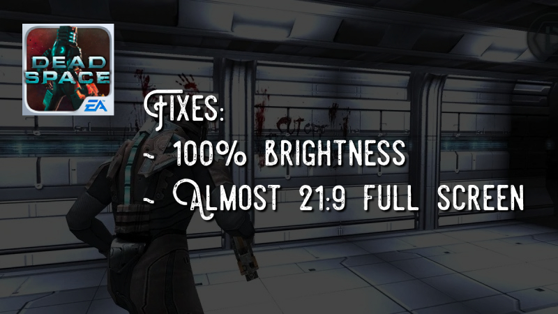

# Dead Space Mobile — Native Windows/Linux rebuild (research stage)

> **No playable PC game exists yet.** The project now has independently written
> and actual-APK-tested native **texture and mesh extraction** tools, plus the
> desktop host foundation. Original game scene, animation, physics, input
> semantics, audio, AI, combat and mission loop are **not implemented**.

## Current native reconstruction checkpoint (November 1, 2026)

- Actual original ARM `0x28A718` resource-resolver call/branch sequence
  reconstructed in native C++, invoked from original mode-one handle
  constructor `0x28B3A4`. Buffer zeroing, object return on failed
  lookup, conditional vtable +0x3C/+0x2C dispatch and scratch release
  match original instruction evidence. Original allocator, lookup,
  object-method and cleanup implementations still must be recovered.
- Original `0x283408` tree header and `0x2933EC` predecessor
  behavior reconstructed with bounded original-node mapping.
- Three ordered original `0x286918` registration passes now operate
  natively over caller-mapped original resource-tree nodes, using the
  already reconstructed `0x284178` registration and native resource map.
  The preceding original `0x2863EC` parser/loader remains unported.
- Native bounded ARM `0x285918` byte-string append and `0x2863EC`
  missing-suffix copy behavior are implemented. Original UTF-16 range
  constructor `0x285590` is native. The complete resource parser
  `0x2863EC` and the receiver's actual resource insertion remain unported.
- Original token matcher `0x285630` and sorted tree search
  `0x2854B8` use a native case-table-driven token index with
  original unsigned-byte ordering.
- The resource text decoder `0x28CC88` now processes original UTF-8
  into native UTF-16, including malformed-sequence return behavior and
  original four-byte truncation. The two-pass conversion step in
  `0x28611C` and UTF-16 record replacement are native. Outer `0x2862E8`
  record preparation and receiver dispatch are integrated, but original
  receiver `0x278018` remains unported.
- Native original `0x2710A8` UTF-16 receiver tree search with
  `0x26E670` comparator, owner flags and `0x278018` no-match path
  are integrated into `0x2862E8`. Matching resources still require
  the original receiver's stream/allocator/object-creation path.
- Original receiver activation `0x278E58` now performs native
  tree reset and flag updates, with original resource ownership
  cleanup required for nonempty trees. Original `0x26C410`
  receiver mode/parameter updates are native, including the
  conditional original owner reset call. Normal startup still
  cannot activate the real resource provider.
- Original `0x27A768` resource-engine owner and embedded
  `0x27A4F0` constructor fields are now constructed on native
  x86-64 from the confirmed APK layout. The C++ engine object owns
  its mapped ARM32 state, mode transitions, activation and receiver
  lookup. Original `0x286918` now begins with native construction
  and `0x26C410` mode setup, stopping at the missing
  `0x278778` resource-binding call.
- Original `0x278778` resource-owner binding now follows the
  verified no-provider early-exit path, invoking native receiver
  activation and protecting live resource-tree nodes. Original
  `0x271914` reads the shared singleton global `0x0049BCA8`
  and can construct `0x27E560` natively when the slot is empty.
  The original `0x27541C` 0x21C-byte UTF-16 string object is
  also constructed in native C++ with original pointer layout.
  **Actual non-null resource-provider activation remains incomplete.**
- Original receiver provider-mode check `0x2733E8` now
  executes the native verified rejection branch, while the
  accepted-mode path constructs all three original `0x27541C`
  UTF-16 temporary objects in the mapped `0x278E58` stack
  frame. Actual resource streaming through provider `+0x2C`
  and owner `+0x70` still requires original native methods.
- Original mode-8 owner stream `0x276FE4` can now read
  64-byte chunks of caller-provided game data into native
  growable byte strings. The distinct original `0x26D5FC`
  decoder converts those resource lines to owned UTF-16
  preserving original malformed-input and 4-byte truncation
  behavior. The constructed native resource owner exposes
  both byte and wide text lines, but real provider virtual
  methods and game-scene registration are still unported.
- The original embedded provider vtable `0x004896F8` has
  native `+0x14` (`0x26C3C4`) mode and in-memory
  `+0x28` (`0x271794`) position implementations.
  Owners that supply their actual embedded provider no longer
  require an invented callback to query its mode. External
  provider seek/read methods and full game boot remain incomplete.
- Original provider +0x18 error state, +0x20 cached size,
  +0x28 memory/file position, and +0x2C verified seek
  operations are now native. Actual original ELF import
  symbols confirm that file-mode +0x34 uses libc `read`
  and +0x2C uses `lseek`; both have portable
  Windows/Linux native implementations.
- The original owner can now consume a **real opened
  user-owned asset file** in its default mode 8,
  producing UTF-16 resource text via the original
  `0x276FE4`/ `0x26D5FC` path. The native host
  adapter requires an explicitly matching file
  descriptor and preserves CRLF, chunk boundaries,
  EOF and size limits. The in-memory codec,
  complete resource registration, scene renderer
  and gameplay engine remain incomplete.
- **68/68 synthetic native CTests passed on Windows and Linux** at
  [verification run 41343352738](https://github.com/daniyalshakeel5/Dead-Space-Mobile-PC-port/actions/runs/41343352738).
  These tests do not prove real game-engine boot or scene rendering.
  [Latest detailed handoff](docs/HANDOFF_2026-11-01.md).

## Goal

A genuine native x86-64 Windows/Linux game rebuilt in portable C++17/CMake,
with efficient keyboard/mouse and OpenGL/SDL2 rendering, **no Android
emulator**, no ARM instruction translation, and no proprietary game files
shipped inside the executable or installer.

The user's legally obtained mobile APK provides their local assets. This
repository is an independent study and is not affiliated with the original
game publisher.

## Verified tools and current scope

| Utility/component | What it actually does | Evidence |
| --- | --- | --- |
| `ds_input_probe`, host timing | SDL2 keyboard/mouse diagnostic and fixed-step host scheduler; not original game logic | Windows/Linux synthetic CTest |
| `ds_apk_probe`, `ds_asset_install` | ZIP32 APK inspection and safe fresh-directory `assets/` installation from a user-owned APK | Windows/Linux synthetic CTest |
| `ds_m3g_probe` | Strict JSR-184 checks and an explicitly separate IronMonkey diagnostic on user-provided texture files | Actual APK structural checks |
| `ds_m3g_texture_extract` | User-local texture → PNG for native-supported raw RGBA or ETC1 full-mipmap formats | **67** native RGBA and **99** native ETC1 base-mip decodes; 3+3 ephemeral PNGs validated |
| `ds_im_mesh_extract` | User-local IM-M3G geometry → new OBJ with XYZ vertices and basic triangles, **no materials/UVs/rigs** | **37/91** resources passed real-APK C++ decoder, 3 ephemeral OBJ files checked |
| Python research tools | Aggregate-only native ELF, resource signatures, mesh reference and format probes | Real APK GitHub Actions, plus synthetic fixture tests |

Original APK model/texture assets are **never committed, bundled or
published**. GitHub Actions temporarily downloads the original upstream
release confirmed by the user to be the same file they own, performs
research and deletes the temporary copy. All published research reports
contain aggregate counts, not original contents.

### Real game evidence

- `.m3g` signatures: 174 JSR-184-like and 91 proprietary `IM-M3G`.
- Image2D: 67 native raw RGBA images, 99 native ETC1 base-level decodes from
  complete mipmap chains; one additional code-116 resource remains unsupported.
- Geometry: 37 resources decoded into **4,154 meshes, 4,362 submeshes,
  546,488 vertices, 398,634 triangles**. The other 54 IM-M3G files are
  not decoded by this geometry-only tool.
- No verified game renderer, full texture/material/UV mapping, correct
  scene orientation, skinned characters or native x86-64 gameplay.

[Native original-APK geometry verification](https://github.com/daniyalshakeel5/Dead-Space-Mobile-PC-port/actions/runs/41292859630) ·
[Native ETC1 decoder verification](https://github.com/daniyalshakeel5/Dead-Space-Mobile-PC-port/actions/runs/41291717211) ·
[Technical handoff](docs/HANDOFF_2026-11-01.md)

## Download native diagnostic utilities

Open [GitHub Actions — Native asset installer](https://github.com/daniyalshakeel5/Dead-Space-Mobile-PC-port/actions/workflows/asset-installer.yml)
and download the Windows or Linux artifact from a successful CI run.
Only independently written diagnostic programs are packaged, never the game.

## Use with your own APK assets

The installer creates a **new** destination folder (does not overwrite it):

```powershell
# Windows PowerShell
.\ds_asset_install.exe "D:\Games\DeadSpaceMobile.apk" "D:\Games\DeadSpaceAssets"
```

```sh
# Linux
./ds_asset_install "$HOME/Games/DeadSpaceMobile.apk" "$HOME/Games/DeadSpaceAssets"
```

Run these tools on **local files extracted from that owned APK**:

```sh
ds_m3g_probe "<local-texture.m3g>" --decode-image
ds_m3g_texture_extract "<local-texture.m3g>" "<new-output.png>"
ds_im_mesh_extract "<local-model.m3g>"
ds_im_mesh_extract "<local-model.m3g>" "<new-output.obj>"
```

The texture extractor supports verified raw RGBA and ETC1 resources only;
the geometry extractor supports a verified position/triangle-only subset.
They reject unsupported files and refuse to overwrite output files.
The user's extracted PNGs/OBJs contain copyrighted game content; **do not
upload or redistribute them**.

## Native CMake build

CMake 3.20+, a C++17 compiler, zlib dev libraries for optional APK
installer / M3G texture formats, SDL2 if enabling its windowed diagnostic:

```sh
cmake -S . -B build -DCMAKE_BUILD_TYPE=Release \
  -DDS_BUILD_INPUT_PROBE=OFF \
  -DDS_BUILD_ASSET_INSTALLER=ON \
  -DDS_BUILD_M3G_READER=ON \
  -DDS_BUILD_IM_MESH_READER=ON \
  -DDS_ENABLE_TESTS=ON
cmake --build build --config Release
ctest --test-dir build --build-config Release --output-on-failure
```

Heavy builds/actual resource processing should run via GitHub Actions;
the assistant's local VM has been unstable during archive work.

## Next engineering gate

Continue reconstructing the **actual original engine**, not additional
standalone model viewers. The immediate dependency is the original
provider-backed resource/parser bridge: finish original mode-8
`0x276D18` postprocessing and the non-null `0x278E58` receiver
object creation; connect original-asset text and resource entries
to real native scene entities. Then implement native rendering
of the game scene and the original input, frame scheduling,
physics, animation and gameplay loop. Current binary still
stops when an unrecovered original engine routine is needed.
A passing resource test is not a playable game.

## Upstream attribution and licensing

- Original mobile brightness/aspect-ratio fixes:
  [RAFALAMAO/Dead-Space-Mobile-Fixes](https://github.com/RAFALAMAO/Dead-Space-Mobile-Fixes)
- Existing game format investigation:
  [Sleepyzay Noesis/Maxscript](https://github.com/sleepyzay/Maxscript-Projects/tree/main/Dead%20Space%20Mobile);
  [RaduMC/M3G2FBX](https://github.com/RaduMC/M3G2FBX);
  [ResHax Dead Space Mobile formats](https://reshax.com/topic/1460-mobile-dead-space-m3g-modeltexture-bundles-help/)
- Source/reference format:
  [JSR-184](https://wupp.cc/j2meapi/JSR_184_Mobile_3D_Graphics_API_1_1/file-format.html)

Independent code does not grant redistribution rights for the original
game's copyrighted assets or executable.



## Resume work

Read [current handoff](docs/HANDOFF_2026-11-01.md) and
[M3G evidence](docs/M3G_FORMAT_EVIDENCE_2026-11-01.md). Continue development
on `work/deadspace-remote-preflight-2026-11-01` and [draft PR #1](https://github.com/daniyalshakeel5/Dead-Space-Mobile-PC-port/pull/1).
